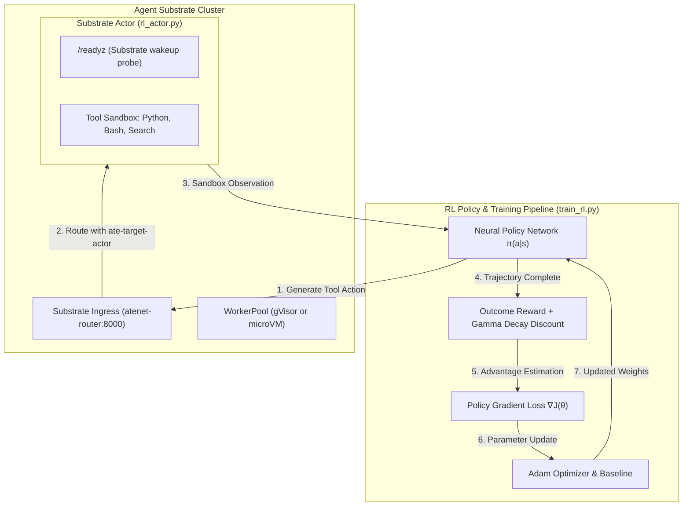

# Reinforcement Learning Workload (`rl-rollout`)

An end-to-end Reinforcement Learning workload for benchmarking **Agent Substrate**.

This workload models the agentic RL architecture popularized by **Kimi-Researcher** and OpenAI Deep Research: an on-policy policy gradient trainer (`REINFORCE`) running multi-turn rollouts against sandboxed, stateful execution environments hosted as **Substrate Actors** (isolated via gVisor or microVM).

---

## Architecture Overview



### Components

1. **Substrate Actor (`rl_actor.py`)**:
   Runs inside the Substrate Actor pod on port 80:
   - `/readyz`: Substrate wakeup probe.
   - `/step`: Multi-turn tool execution endpoint (supports `python` code execution, `bash` command execution, and deterministic `search`).
   - `/reset`: Resets sandbox state across episodes.
   - `/invoke`: High-throughput prompt endpoint compatible with the Locust benchmark harness.

2. **RL Training Pipeline (`train_rl.py`)**:
   - Implements on-policy **REINFORCE** with advantage estimation against a moving baseline.
   - Evaluates multi-turn reasoning and tool-augmented QA tasks.
   - Computes **Kimi-Researcher style outcome rewards**:
     $$r_i = R_{outcome} \times \gamma^{T - 1 - i}$$
     where $\gamma \in (0, 1)$ rewards shorter, direct problem-solving trajectories over meandering loops.
   - Tracks convergence, accuracy, step counts, and Substrate round-trip latency.

3. **Locust Benchmark Driver (`locust/go/internal/workload/rl_rollout.go`)**:
   Integrates with Locust and Boomer to drive load against `rl-rollout` actors on Substrate clusters.

---

## How to Run & Reproduce

### 1. Standalone / Zero-Dependency Mode (Local)

Run the RL training loop directly without needing a cluster or external GPUs:

```bash
python3 benchmarking/workloads/images/rl-rollout/train_rl.py --epochs 40 --batch-size 8 --lr 0.03
```

This trains the neural policy network, outputs training logs, and saves:
- `rl_policy.npz`: Trained model weights.
- `rl_training_report.json`: Convergence metrics, loss history, and step counts.

### 2. Against a Running Substrate Actor

When Substrate is deployed (or using port-forwarding to the router):

```bash
# Start local actor server (or deploy ActorTemplate on Substrate)
python3 benchmarking/workloads/images/rl-rollout/rl_actor.py &

# Train against the actor endpoint
python3 benchmarking/workloads/images/rl-rollout/train_rl.py \
  --actor-url http://127.0.0.1:80 \
  --epochs 40
```

On a live Substrate cluster with `atenet-router`:

```bash
python3 benchmarking/workloads/images/rl-rollout/train_rl.py \
  --actor-url http://atenet-router.ate-system.svc.cluster.local:8000 \
  --target-actor benchmark-workloads/rl-rollout-1 \
  --epochs 40
```

### 3. Run Unit & Integration Tests

```bash
python3 -m unittest benchmarking/workloads/images/rl-rollout/test_train_rl.py
```
